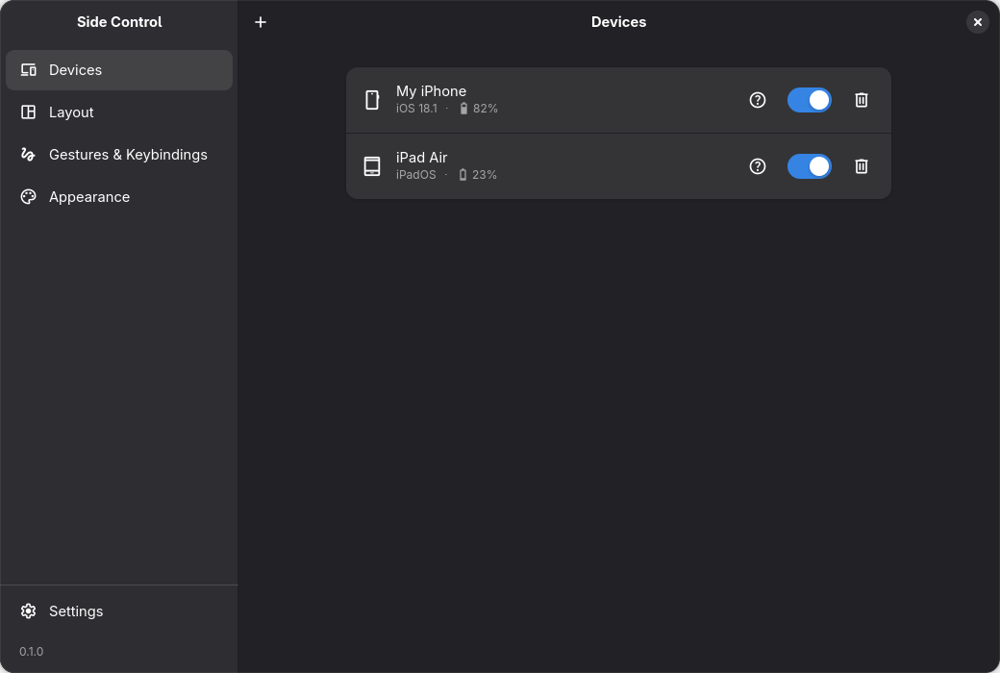
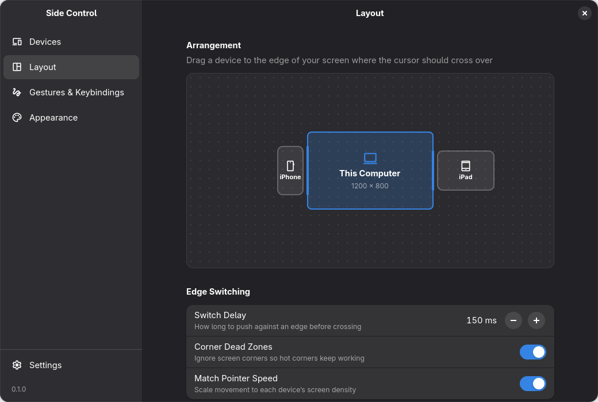
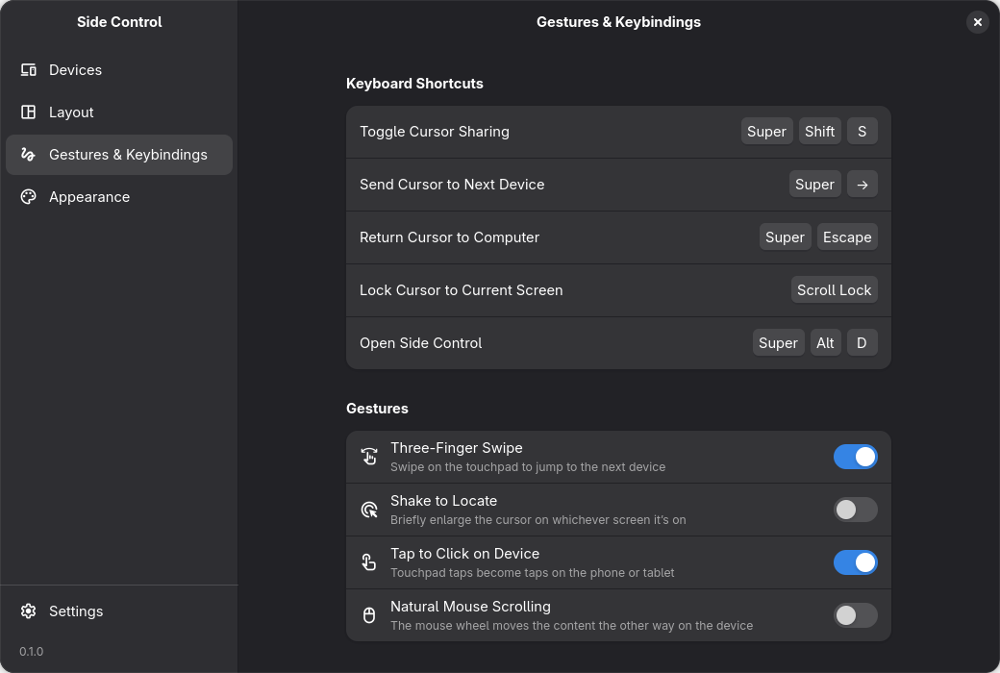
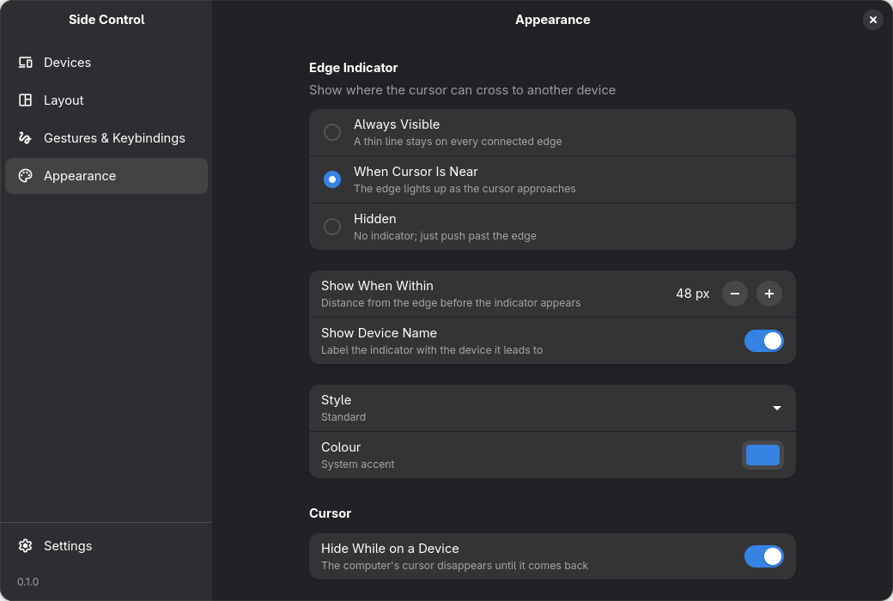
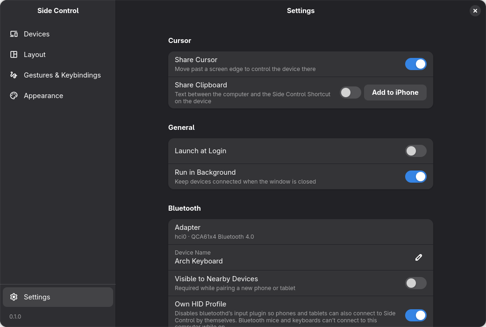

# Side Control

Use your Linux laptop's keyboard and touchpad on your iPhone and iPad. Push the cursor off the edge of
your screen and it appears on the phone next to it, push it back and it returns. Universal Control,
for Linux.



Side Control makes your computer a Bluetooth keyboard and mouse for each paired device. No app runs on
the phone or tablet: it sees an ordinary Bluetooth keyboard and mouse.

> **Status: early release (0.1.0).** Developed and tested on Arch Linux with Hyprland, an iPhone and an
> iPad. Other distributions and compositors should mostly work, see [Requirements](#requirements).

## Supported devices

| Device | Status | Notes |
|---|---|---|
| iPhone | Supported | Needs **AssistiveTouch** turned on (Settings → Accessibility → Touch → AssistiveTouch): iOS only shows a pointer with it. |
| iPad | Supported | Works as is: iPadOS has its own pointer. AssistiveTouch is only needed for the extra mouse buttons (Home, Control Center, …). |
| Android phone / tablet | Untested | Pairs and should work as a Bluetooth keyboard and mouse. Reports are welcome. |

## Features

- **Edge hand-off.** Arrange your devices around your screen; the cursor crosses where you put them,
  entering at the same height it left, and comes back the same way.
- **Keyboard and touchpad on the device.** Typing, clicks, tap to click, two-finger scrolling, and
  two-finger left/right swipes that turn the page (Photos, the Home Screen, ...).
- **Gestures.** Three-finger swipe left/right jumps between your computer and devices; three-finger
  swipe up goes Home.
- **Keyboard shortcuts.** Send the cursor to the next device or back, lock it to the current screen,
  turn sharing on and off.
- **Edge indicator.** A line on your screen edge shows where each device is reached. Choose its style (Subtle, Standard, Bold, Glow) and colour.
- **Cursor out of the way.** While a device has control, the computer's cursor is hidden (Hyprland); it
  comes back where you return. Turn it off in Appearance.
- **Tray icon.** Shows where the cursor is and switches between devices (StatusNotifierItem, e.g. Waybar).
- **Pairing and device info.** Pair from the app; see each device's OS version and battery.

| | |
|---|---|
|  |  |
|  |  |

## Install

### AppImage

Download `Side_Control-<version>-x86_64.AppImage` from the
[latest release](https://github.com/Rakura-cloud/side-control/releases/latest), then:

```sh
chmod +x Side_Control-*-x86_64.AppImage
./Side_Control-*-x86_64.AppImage
```

It bundles Python, GTK and everything else it needs, so it runs on any x86_64 distribution. Your system
still needs what Side Control talks to: BlueZ, polkit, and Hyprland for edge hand-off (see below).

### From source

Install the [requirements](#requirements), then:

```sh
git clone https://github.com/Rakura-cloud/side-control.git
cd side-control
./side-control
```

### First run

Side Control asks for your password to start its backend, which runs as root. Turn on
**Settings → Launch at Login** to start it with your session; it then stays in the tray.

Then, for each device:

1. Click **+** in Side Control, then open **Settings → Bluetooth** on the phone or tablet and pick it
   from the list in Side Control.
2. On an iPhone, turn on **Settings → Accessibility → Touch → AssistiveTouch** (see
   [Supported devices](#supported-devices)). You can turn off **Always Show Menu** to hide its floating
   button.
3. In Side Control's **Layout** page, drag the device to the side of your screen where it sits.

### Bluetooth mice and keyboards on the computer

The two Bluetooth channels a keyboard or mouse uses can only be held by one program, either Linux's
own Bluetooth input support or Side Control. **Settings → Own HID Profile** chooses:

- **Off** (Bluetooth mice and keyboards work): Side Control connects to your devices itself, within
  10 to 30 seconds after they come in range.
- **On:** your devices can also connect to Side Control by themselves, but classic Bluetooth mice and
  keyboards can't connect to this computer. It installs
  [`bluetooth-no-input.conf`](side_control/data/bluetooth-no-input.conf) as a drop-in for
  `bluetooth.service` (bluetoothd runs with `-P input`).

Bluetooth LE mice and keyboards (most recent ones, e.g. Logitech MX) use another plugin and work either
way. Mice and keyboards that connect after Side Control started, or reconnect after sleeping, are picked
up within a second.

## Requirements

Needed by the AppImage too:

- **Linux with BlueZ** and a Bluetooth adapter (Bluetooth Classic, which nearly all have).
- **polkit** (`pkexec`): the backend runs as root to use Bluetooth sockets and read your keyboard and
  touchpad, and Side Control starts it through `pkexec`.
- **Hyprland** for edge hand-off: Side Control asks it where the cursor is. On other compositors
  everything else works, and you switch with the shortcuts or the three-finger swipe instead.

Bundled in the AppImage, needed when running from source:

- **Python 3** with PyGObject, pycairo, dbus-python and python-evdev.
- **GTK 4 and libadwaita.** Tested with GTK 4.24 and libadwaita 1.10; older versions may lack widgets
  the app uses.
- **gtk4-layer-shell** (optional) for the on-screen edge indicator.

On Arch Linux:

```sh
sudo pacman -S python python-gobject python-cairo python-dbus python-evdev gtk4 libadwaita \
    bluez bluez-utils polkit gtk4-layer-shell
```

## Usage

| Shortcut | Action |
|---|---|
| Push the cursor off a screen edge | Move to the device on that side |
| <kbd>Super</kbd>+<kbd>→</kbd> | Send the cursor to the next device |
| <kbd>Super</kbd>+<kbd>Esc</kbd> | Bring the cursor back to the computer |
| <kbd>Super</kbd>+<kbd>Shift</kbd>+<kbd>S</kbd> | Turn cursor sharing on or off |
| <kbd>Scroll Lock</kbd> | Lock the cursor to the screen it is on |
| <kbd>Super</kbd>+<kbd>Alt</kbd>+<kbd>D</kbd> | Open Side Control |
| <kbd>Ctrl</kbd>+<kbd>Alt</kbd>+<kbd>P</kbd> | Computer → first device → next device → … → computer |
| <kbd>Ctrl</kbd>+<kbd>Alt</kbd>+<kbd>H</kbd> / <kbd>C</kbd> / <kbd>N</kbd> / <kbd>S</kbd> | Mouse buttons 4–7 on the device: assign them under AssistiveTouch → Devices → (this computer) → Customize Additional Buttons (e.g. Home, Control Center, Notification Center) |

| Touchpad, while a device has the cursor | Action |
|---|---|
| Two fingers up/down | Scroll |
| Two fingers left/right | Turn one page |
| Pinch | Zoom, through the Zoom shortcuts of Accessibility → Zoom (turn on Zoom and its Keyboard Shortcuts) |
| <kbd>Ctrl</kbd> + pinch | Zoom in the app (<kbd>⌘</kbd><kbd>+</kbd> / <kbd>⌘</kbd><kbd>−</kbd>, e.g. Safari) |
| Three fingers up | Home (mouse button 4, assign it in AssistiveTouch as above) |
| Three fingers left/right | Previous / next device, the computer included |

A mouse works on the device too, one to one (no acceleration; `MOUSE_ACCEL_*` in
[`config.py`](side_control/backend/config.py) turn it on). Its wheel and tilt wheel scroll (**Natural
Mouse Scrolling** turns them the other way), and its back / forward buttons are mouse buttons 4 and 5
(assign them in AssistiveTouch as above).

## Known limitations

- **The cursor position on the device is estimated.** Bluetooth mice only send movement, and iOS never
  tells where its pointer is. Side Control keeps its own estimate using each model's screen size, and
  re-anchors it whenever the pointer is pushed against an edge. iOS pointer acceleration can still make
  it drift, so the cursor may come back to the computer a little early or late.
- **Swipes and pinches are imitated.** A mouse cannot swipe or pinch on iOS, so a swipe is a short,
  quick drag (one page per swipe; apps that need a longer swipe may not react) and pinching uses the
  Accessibility Zoom shortcuts.
- **Share Clipboard** is a saved setting only: a Bluetooth keyboard and mouse cannot carry a clipboard.
- **Shake to Locate** enlarges the computer's cursor (Hyprland only); the device's pointer is not
  affected.
- Shortcuts reach your compositor too, since the keyboard is only taken over while a device has the
  cursor.

## How it works

Side Control is two programs that talk JSON over the unix socket `/run/side-control.sock`:

- **The app** ([`side_control/app/`](side_control/app/), started by `./side-control`) is the GTK window,
  tray icon and edge indicator, running as you. Settings are stored in
  `~/.config/side-control/settings.json`.
- **The backend** ([`side_control/backend/`](side_control/backend/), started by
  `./side-control-backend`) runs as root. It registers a Bluetooth HID keyboard and mouse with BlueZ,
  reads your keyboard and touchpad with evdev, takes them over while a device has the cursor, and sends
  HID reports to it.

[AGENTS.md](AGENTS.md) maps out every module.

## Contributing

See [CONTRIBUTING.md](CONTRIBUTING.md). Bugs and ideas: [issues](https://github.com/Rakura-cloud/side-control/issues).

## License

[GPL-3.0-or-later](LICENSE).

The `sc-*` icons in [`side_control/data/icons/`](side_control/data/icons/) are
[Material Symbols](https://github.com/google/material-design-icons) by Google, under the
[Apache License 2.0](side_control/data/icons/LICENSE-Material-Symbols).
